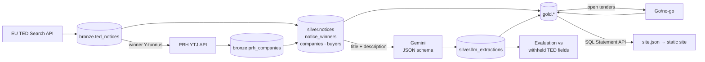

# infra-intelligence

**Tender and market intelligence for Finnish infrastructure contractors, built on public data with a lakehouse
pipeline and an LLM layer that is measured, not just demoed.**

A bid team has three recurring questions: *which open tenders are worth our effort, who are we up against, and
where is competition thin?* This project answers them from EU procurement data (TED) and the Finnish company
register (PRH), and adds a go/no-go assessment for every open tender.

> Status: the full pipeline runs daily on Databricks (Bronze → Silver → LLM → Gold → evaluation and go/no-go).
> The demo site reads exported Gold data.

## What it shows

| Question | Answer in the data |
|---|---|
| Who wins? | Wins and single-winner contract value per company, by year and category |
| Where is competition thin? | Share of awards with ≤ 2 bids, per category and region |
| Who buys, and is there an incumbent? | Buyer profiles with the most frequent winners and their share |
| Which open tenders fit us? | Each open competition with history (same buyer, same region) and a go/no-go score |
| How far apart are bids? | Lowest vs highest bid where both are reported |

First findings from 814 notices (1/2024–10/2026):

- **Competition is uneven.** In water construction 88 % and in rail 64 % of awards drew at most two bids, versus
  16 % in road maintenance.
- **State road maintenance is concentrated.** One contractor won 40 % of the ELY centres' awards.
- **Bids spread widely.** Where both are reported, the highest bid is typically ~35 % above the lowest.

## Architecture



An **ELT pipeline following the medallion architecture**: raw data lands unchanged in Bronze, Silver cleans and
conforms it, and Gold holds business-ready tables. Because raw data is kept, data quality fixes only require
re-running the transform layers, not re-fetching from the sources.

All compute runs on **Databricks Free Edition** (serverless, Unity Catalog, Delta). Notebooks import a tested Python
package from `src/`, so business logic is unit tested locally and the notebooks stay thin.

| Layer | Tables | Notes |
|---|---|---|
| Bronze (raw) | `ted_notices`, `prh_companies` | Raw JSON, incremental and idempotent `MERGE`; PRH lookups cached and refreshed every 90 days |
| Silver (cleaned, conformed) | `notices`, `notice_winners`, `companies`, `buyers`, `llm_extractions` | Typed records, infra scope by main CPV, entity resolution by business ID |
| Gold (business-ready) | `market_share`, `competition`, `competition_by_region`, `buyer_profiles`, `open_tenders`, `price_spread`, `bid_assessments`, `bid_factor_backtest`, `llm_eval_metrics` | SQL with `GROUPING SETS` rollups and in-notebook quality assertions |

## Design decisions

**The LLM is used where text is the only source, and nowhere else.**
Company names are resolved by business ID (Y-tunnus) through the PRH register, not by a model. The LLM reads tender
descriptions to extract what has no structured field: location, contract period, work types, requirements, risks and
price-index terms. Example: state road maintenance contracts are tagged "Finland" in TED; the place appears only in
the title ("Maanteiden hoitourakka Viinijärvi"), and the model maps Viinijärvi → Liperi → Pohjois-Karjala.

**Extraction is evaluated against labels the model never sees.**
TED has structured region (NUTS) and value fields for many notices. They are withheld from the prompt and used as
ground truth, giving accuracy, coverage and a hallucination signal for euro amounts without manual labelling.
Results are stored per prompt version, so prompt changes can be compared.

| Metric (extract-v1, Gemini 3.5 Flash Lite) | Result | n |
|---|---|---|
| Region given for single-region notices (coverage) | 98 % | 557 |
| Given regions that match TED (precision) | 96 % | 546 |
| Correct region over all single-region notices | 94 % | 557 |
| Euro value within ±5 % of TED, where both exist | 68 % | 22 |

Most region errors are neighbouring regions (e.g. Satakunta vs Varsinais-Suomi for contracts on their border).
Euro values are the weak spot: few notices state one in the text, so the field is not used in scoring.

**The go/no-go score is computed, not generated.**
The model rates two qualitative factors with reasons, *fit* to a bidder profile and *risk*. *Competition* comes from
historical bid counts. A fixed weighted formula (fit 40 %, competition 30 %, risk 30 %) produces the 0–100 score and
the recommendation, so results are reproducible and the model does no arithmetic.

**The history factors are backtested, and the data overruled two intuitions.**
Each past award is predicted using only awards published before it (`gold.bid_factor_backtest`, rebuilt daily):

| Bid-count estimate | Mean absolute error (bids) | n |
|---|---|---|
| Most specific history first (region → buyer → category) | 2.2 | 212 |
| Category average | 2.08 | 212 |
| Buyer average shrunk toward the category average, *(n·buyer + 3·category) / (n + 3)* | **2.0** | 212 |

Regional history looked most relevant but was the noisiest: a region rarely has more than a handful of comparable
awards. The score now uses the shrunk estimate. An incumbent bonus was also considered, but the winner of the previous
comparable award (same buyer, category and region) won the next one in only 23 % of cases (n = 75), below the 33 %
expected for a random bidder. Past winners are shown to the bid team as context, not scored.

**Privacy by default.** Sole traders often trade under a personal name. A winner's name is published only if PRH
open data knows the ID as a company that is not a sole trader; others are grouped as *Muut toimijat*. A Gold
assertion fails the run if a hidden name leaks, and tender descriptions are not exported to the site.

**Zero cost.** Databricks Free Edition, Gemini free tier, public APIs and GitHub. The pipeline is built for those
limits: LLM calls are batched, processed once per prompt version, resumable after a quota stop, and fall back to
another free model when one is overloaded or out of daily quota.

## Data quality issues found and handled

| Issue | Handling |
|---|---|
| ~30 % of CPV-matched notices were building projects with earthworks as a secondary CPV | Filter on the procedure's main CPV in Silver; Bronze keeps everything |
| Winner names and IDs are parallel arrays that are not aligned in multi-winner (framework) notices | Link names to IDs only from single-winner notices; official names from PRH |
| The same company reported as Y-tunnus or VAT number (`2163026-3` vs `FI21630263`) | Normalise to Y-tunnus before resolution |
| ELY centres renamed to Elinvoimakeskus in 2026, all under one buyer ID | Resolve buyers by ID with one display name |
| TED mixes NUTS 2021 and 2024 region codes (several regions renumbered) | Union code list; verified that no code changes meaning |
| Bid counts reported as several statistics per lot | Use total tenders, falling back to e-submissions (mandatory above EU thresholds) |
| Multi-lot tenders made "single-bid" rates look inflated (talvihoito 48 %) | Count a tender as low-competition only if no lot got more bids (34 %) |
| Highest bid 500× the lowest | Exclude spreads above 5× as unit or lot mix-ups |

## Limitations

- Only tenders above EU thresholds (works ≈ €5.5M) are in TED; smaller national tenders are out of scope.
- Framework agreement values cannot be attributed to individual winners.
- History starts in 2024. The winner ID and bid-count fields come from eForms (mandatory since late 2023); older
  notices use a different format and are not parsed.
- The go/no-go assessment uses a fictional example bidder profile.
- Independent portfolio project, not affiliated with any company or authority in the data.

## Repository layout

```
src/infra_intelligence/
  ingest/      TED and PRH API clients
  transform/   Silver parsing, name cleaning, company records
  llm/         Gemini client, extraction, evaluation, go/no-go
  export/      Databricks SQL client, site.json builder
notebooks/     01 Bronze · 01b PRH · 02 Silver · 03 Gold (SQL) · 04 extraction · 05 evaluation · 06 go/no-go
scripts/       export_site_data.py
site/          static demo (HTML/CSS/JS, no build step)
tests/         unit tests (stdlib unittest, mocks for all external APIs)
```

## Running

```bash
python -m unittest discover -s tests -t .      # 101 tests, no network
```

On Databricks the pipeline runs as the scheduled job `infra-intelligence-daily` (10:30 Europe/Helsinki, after
the Gemini daily quota resets). It checks the notebooks out from this repo on every run:

```
bronze_ted → bronze_prh → silver → llm_extract → gold → llm_eval
                                                      └→ bid_assessment
```

Gold runs even if the LLM step fails (e.g. quota), so market tables stay fresh. The Gemini key is read from a
secret scope: `databricks secrets put-secret infra-intelligence gemini-api-key`.

The GitHub Actions workflow `export-site-data` exports Gold to `site/data/site.json` every day after the job and
commits it if the data changed. It reads the repository variables `DATABRICKS_HOST` and `DATABRICKS_WAREHOUSE_ID`
and the secret `DATABRICKS_TOKEN`. When the token expires the workflow fails; create a new token in Databricks
(Settings → Developer → Access tokens) and replace the secret.

Export manually (needs a Databricks token and SQL warehouse ID):

```bash
DATABRICKS_HOST=... DATABRICKS_TOKEN=... DATABRICKS_WAREHOUSE_ID=... python scripts/export_site_data.py
cd site && python -m http.server 8000
```

## Roadmap

- Job definition as code with Terraform (Databricks provider); the scheduled job currently exists via the CLI
- Construction cost index (Statistics Finland) for inflation risk on multi-year contracts
- Azure variant: Terraform module for ADLS Gen2, Key Vault and Data Factory orchestration

## Stack

Python 3 · Databricks (Delta Lake, Unity Catalog, serverless jobs, SQL warehouse) · Spark SQL · Gemini API ·
EU TED API · PRH YTJ API · HTML/CSS/JavaScript
